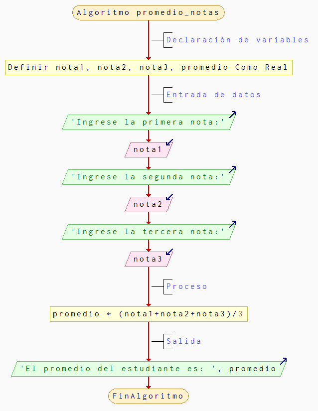

# Ejercicio 01: Cálculo de Promedio

**Nivel:** Básico

## Enunciado

Leer tres notas de un estudiante y calcular su promedio. Mostrar el resultado en pantalla.

## Análisis

Este algoritmo lo resolví definiendo primeramente las tres variables que se utilizarían las cuales definí como Real para que se puedan leer decimales también, el proceso de sacar el promedio sumo las tres notas las cuales pongo en un paréntesis y finalmente las divido, la división la hago de esa manera para que pues la división se haga a las tres notas y no solo a la ultima nota, y finamente muestro en pantalla el resultado de promedio calculado de esas tres notas.

## Pseudocódigo

Algoritmo promedio_notas

    Definir nota1, nota2, nota3, promedio Como Real
	

    Escribir "Ingrese la primera nota:"
    Leer nota1
    Escribir "Ingrese la segunda nota:"
    Leer nota2
    Escribir "Ingrese la tercera nota:"
    Leer nota3
	

    promedio <- (nota1 + nota2 + nota3) / 3
	

    Escribir "El promedio del estudiante es: ", promedio

FinAlgoritmo

## Diagrama de Flujo

