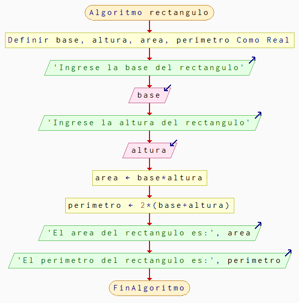

# Ejercicio 02: Área de un Rectángulo

**Nivel:** Básico

## Enunciado

Leer la base y la altura de un rectángulo, calcular y mostrar su área y su perímetro.

## Análisis

En este algoritmo lo que hice es que primero se definen las variables que se van a usar para despues se ingrese la base del rectángulo a calcular, luego asi mismo se ingrese la altura, teniendo esos dos datos lo que hacemos para calcular el área es que se multiplica la base por la altura para después pasar a calcular el perímetro con la formula de 2 x (base + altura), y finalmente mostramos el resultado del área y del perímetro ya calculados 

## Pseudocódigo

```text
Algoritmo rectangulo
	Definir base, altura, area, perimetro Como Real
	
	Escribir "Ingrese la base del rectangulo"
	Leer base
	Escribir "Ingrese la altura del rectangulo"
	Leer altura
	
	area <- base * altura
	perimetro <- 2 * (base +altura)
	
	Escribir "El area del rectangulo es:", area
	Escribir "El perimetro del rectangulo es:", perimetro
	
FinAlgoritmo
```

## Diagrama de Flujo



---
[⬅ Volver al README](../../README.md)
