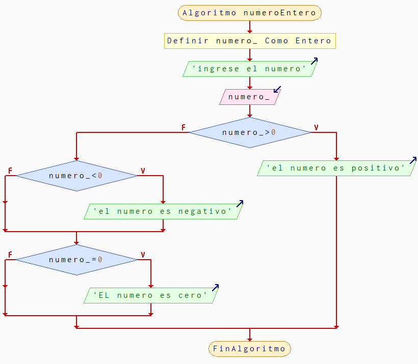

# Ejercicio 03: Positivo, Negativo o Cero

**Nivel:** Básico

## Enunciado

Leer un número entero y determinar si es positivo, negativo o cero. Mostrar un mensaje por cada caso.

## Análisis

En este algoritmo lo que hice fue que primeramente se mostrara el numero a ingresar y ya después añadi las condicionales para que se detectara si el numero era negativo poniendo la condicional de < 0 para que detectara el si el numero era menor a cero pues mostrara el debido mensaje y así mismo con = 0 para que detectara si el numero era únicamente cero para que mostrara también el debido mensaje y finalmente después de ingresar el numero se mostrara el debido mensaje sobre que numero era si era, positivo, negativo o simplemente 0

## Pseudocódigo

```text
Algoritmo  numeroEntero
	
	Definir numero_ Como Entero
	Escribir "ingrese el numero"
	Leer numero_
	si numero_ > 0 Entonces
		Escribir "el numero es positivo"
	SiNo
		si numero_ < 0 Entonces
			Escribir "el numero es negativo"
		FinSi
		si numero_ = 0 Entonces
			Escribir "EL numero es cero"
		FinSi
		
	FinSi

FinAlgoritmo
```

## Diagrama de Flujo




[⬅ Volver al README](../../README.md)
