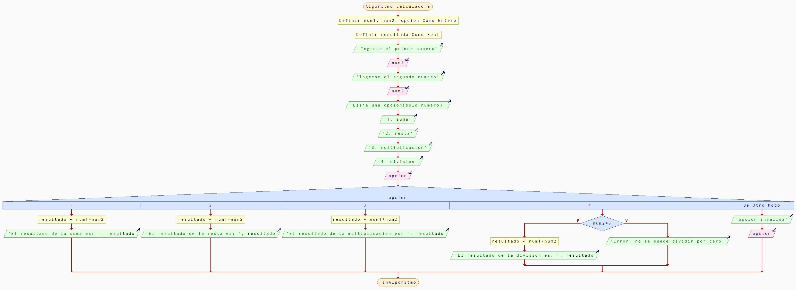

# Ejercicio 04: Calculadora Básica

**Nivel:** Básico

## Enunciado

Leer dos números enteros y una opción (1: Suma, 2: Resta, 3: Multiplicación, 4: División). Realizar la operación correspondiente y mostrar el resultado. Validar que no se divida por cero.

## Análisis

En este pseudocodigo lo que hacemos es que primeramente se definen las variables a utilizar para se ingrese el primer y segundo numero o valor,despues se debe de elegir una de las 4 opciones presentadas si se llegara a elegir una opción que no esta se mostrara un mensaje para señalar el error y la ejecucuion finalizara,despues de elegir amabis números y la opción la cual solo se selecciona ingresando un numero del uno al cuatro se procefe a realizar la debida operación, y finalmente se mostrara en pantalla el resultado final de la operacion

## Pseudocódigo

```text
Algoritmo calculadora
	Definir num1, num2, opcion Como Entero
	Definir resultado Como Real 
	
	Escribir "Ingrese el primer numero"
	Leer num1
	Escribir "Ingrese el segundo numero"
	Leer num2
	
	Escribir "Elija una opcion(solo numero)"
	Escribir "1. suma"
	Escribir "2. resta"
	Escribir "3. multiplicacion"
	Escribir "4. division"
	Leer opcion
	
	Segun opcion Hacer
		1: 
			resultado <- num1 + num2
			Escribir "El resultado de la suma es: ", resultado
			
		2: resultado <- num1 - num2
			Escribir "El resultado de la resta es: ", resultado
			
		3: resultado <- num1 * num2 
			Escribir "El resultado de la multiplicacion es: ", resultado
			
		4:   Si num2 = 0 Entonces
                Escribir "Error: no se puede dividir por cero"
            SiNo
                resultado <- num1 / num2
                Escribir "El resultado de la division es: ", resultado
            FinSi
			
		De Otro Modo:
			Escribir "opcion invalida"
			
	FinSegun
FinAlgoritmo
```

## Diagrama de Flujo



---
