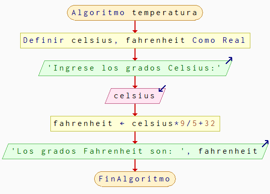

# Ejercicio 05: Conversión de Temperatura

**Nivel:** Básico

## Enunciado

Leer una temperatura en grados Celsius y convertirla a grados Fahrenheit. Mostrar el resultado.

## Análisis

_Explica con tus palabras cómo resolviste el problema: qué datos de entrada hay, qué proceso se hace y qué salida se espera._

## Pseudocódigo

```text
Algoritmo temperatura
	
	Definir celsius, fahrenheit Como Real
	
	Escribir 'Ingrese los grados Celsius:'
	Leer celsius
	
	fahrenheit <- celsius*9/5+32
	
	Escribir 'Los grados Fahrenheit son: ', fahrenheit
	
FinAlgoritmo
```

## Diagrama de Flujo



---
[⬅ Volver al README](../../README.md)
