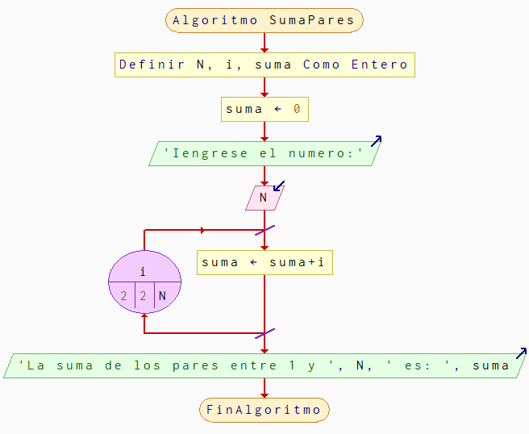

# Ejercicio 06: Suma de Números Pares

**Nivel:** Intermedio

## Enunciado

Leer un número entero N y calcular la suma de todos los números pares comprendidos entre 1 y N. Mostrar el resultado.

## Pseudocódigo

```text

Algoritmo SumaPares
    Definir N, i, suma Como Entero
    suma <- 0
	Escribir "Iengrese el numero:"
    Leer N
    Para i <- 2 Hasta N Con Paso 2 Hacer
        suma <- suma + i
    FinPara
    Escribir "La suma de los pares entre 1 y ", N, " es: ",suma
FinAlgoritmo

```

## Diagrama de Flujo



