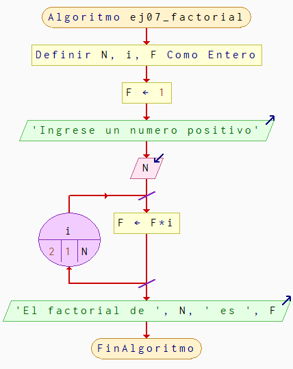

# Ejercicio 07: Factorial de un Número

**Nivel:** Intermedio

## Enunciado

Leer un número entero positivo y calcular su factorial (ej: 5! = 5×4×3×2×1 = 120). Mostrar el resultado.

## Pseudocódigo

```text

Algoritmo ej07_factorial
    Definir N, i, F Como Entero
    F <- 1
    Escribir "Ingrese un numero positivo"
    Leer N
    Para i <- 2 Hasta N Con Paso 1 Hacer
        F <- F * i
    FinPara
    Escribir "El factorial de ", N, " es ", F
FinAlgoritmo

```

## Diagrama de Flujo



---

[⬅ Volver al README](../../README.md)