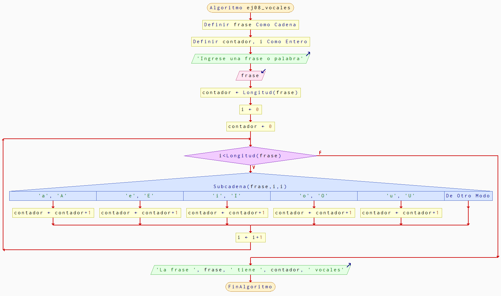

# Ejercicio 08: Contar Vocales en una Cadena

**Nivel:** Intermedio

## Enunciado

Leer una cadena de texto (palabra o frase corta) y contar cuántas vocales contiene. Mostrar el total.

## Pseudocódigo

```text
Algoritmo ej08_vocales
    Definir frase Como Cadena
    Definir contador, i Como Entero
	
    Escribir "Ingrese una frase o palabra"
    Leer frase
	
    contador <- Longitud(frase)
    i <- 0
    contador <- 0
	
    Mientras i < Longitud(frase) Hacer
        Segun Subcadena(frase, i, i) Hacer
            "a", "A":
                contador <- contador + 1
            "e", "E":
                contador <- contador + 1
            "i", "I":
                contador <- contador + 1
            "o", "O":
                contador <- contador + 1
            "u", "U":
                contador <- contador + 1
        FinSegun
		
        i <- i + 1
    FinMientras
	
    Escribir "La frase ", frase, " tiene ", contador, " vocales"
	
FinAlgoritmo
```

## Diagrama de Flujo



---
[⬅ Volver al README](../../README.md)