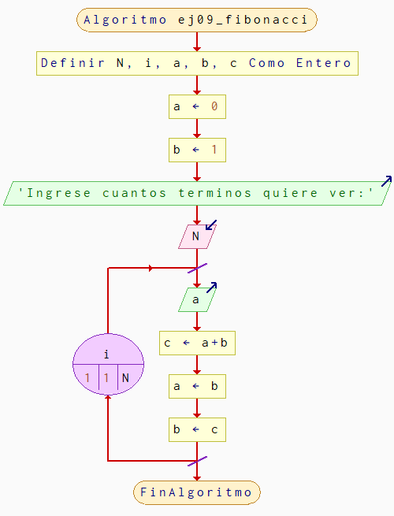

# Ejercicio 09: Serie de Fibonacci

**Nivel:** Intermedio

## Enunciado

Leer un número N y mostrar los primeros N términos de la serie de Fibonacci (0, 1, 1, 2, 3, 5, 8...).

## Pseudocódigo

```text
Algoritmo ej09_fibonacci
    Definir N, i, a, b, c Como Entero
    a <- 0
    b <- 1
    Escribir "Ingrese cuantos terminos quiere ver:"
    Leer N
    Para i <- 1 Hasta N Con Paso 1 Hacer
        Escribir a
        c <- a + b
        a <- b
        b <- c
    FinPara
FinAlgoritmo
```

## Diagrama de Flujo



---
[⬅ Volver al README](../../README.md)
