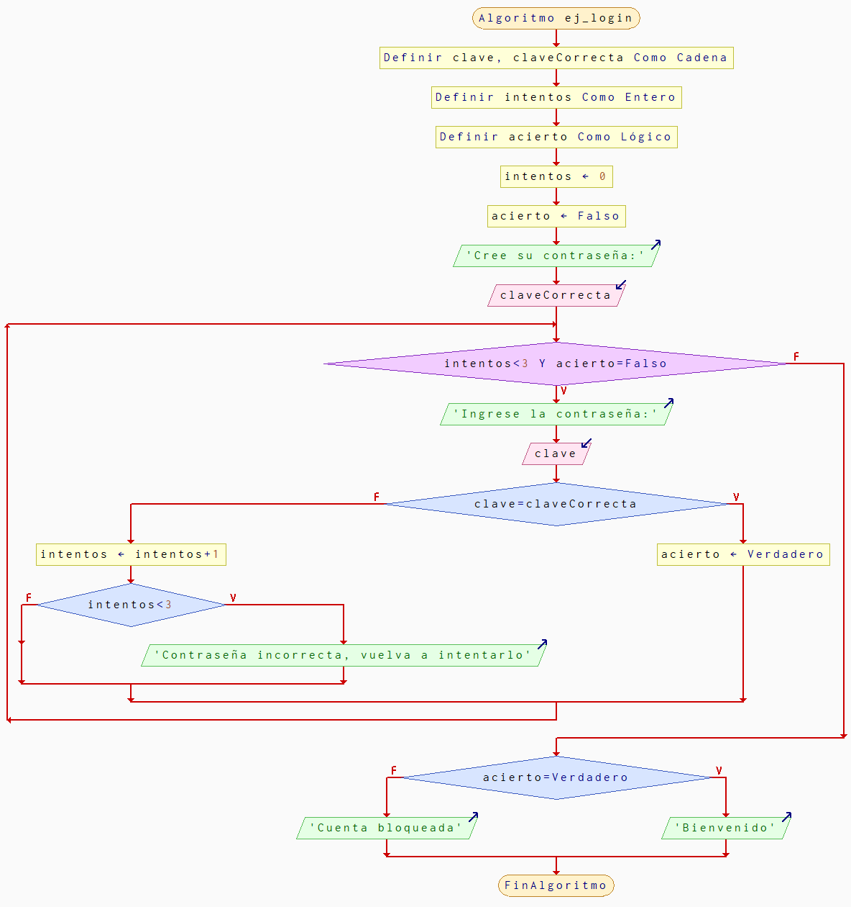

# Ejercicio 10: Validar Contraseña

**Nivel:** Intermedio

## Enunciado

Simular un sistema de login. El usuario tiene 3 intentos para ingresar la contraseña correcta ("12345"). Si acierta, mostrar "Bienvenido". Si falla los 3 intentos, mostrar "Cuenta bloqueada".

## Pseudocódigo

```text
Algoritmo ej_login
    Definir clave, claveCorrecta Como Cadena
    Definir intentos Como Entero
    Definir acierto Como Logico
    intentos <- 0
    acierto <- Falso
    Escribir "Cree su contraseña:"
    Leer claveCorrecta
    Mientras intentos < 3 Y acierto = Falso Hacer
        Escribir "Ingrese la contraseña:"
        Leer clave
        Si clave = claveCorrecta Entonces
            acierto <- Verdadero
        SiNo
            intentos <- intentos + 1
            Si intentos < 3 Entonces
                Escribir "Contraseña incorrecta, vuelva a intentarlo"
            FinSi
        FinSi
    FinMientras
    Si acierto = Verdadero Entonces
        Escribir "Bienvenido"
    SiNo
        Escribir "Cuenta bloqueada"
    FinSi
FinAlgoritmo
```

## Diagrama de Flujo



---
[⬅ Volver al README](../../README.md)
